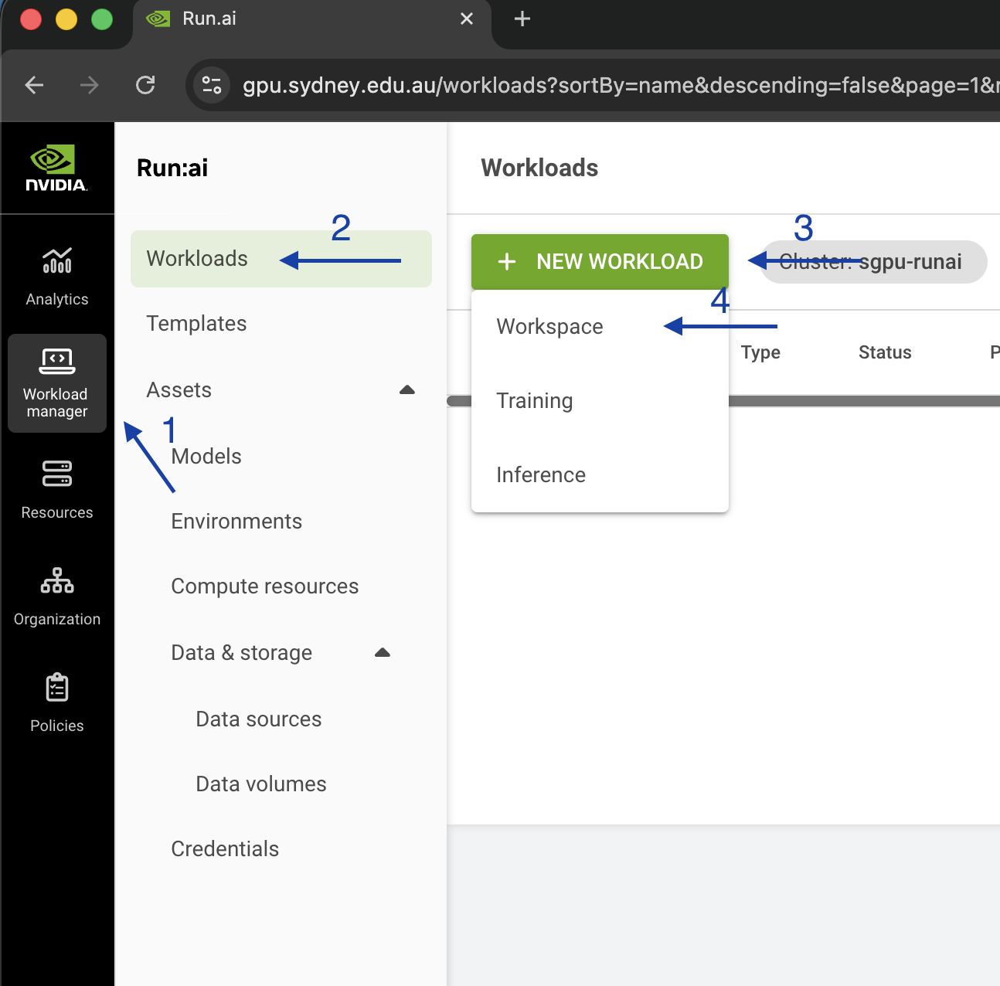
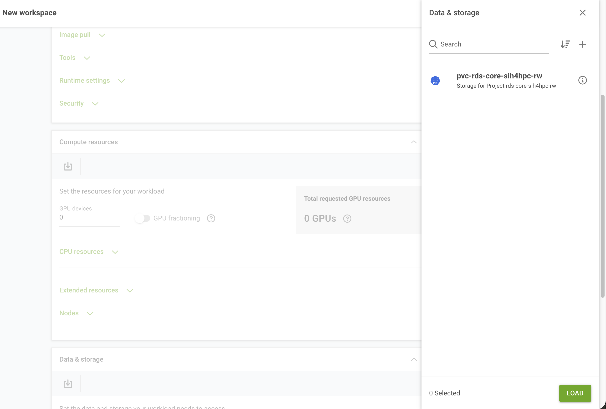
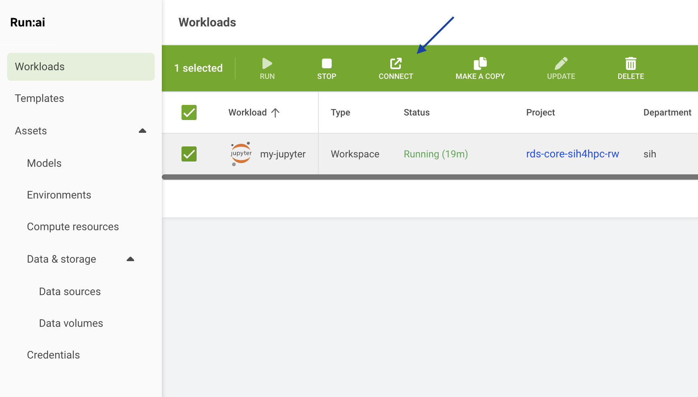
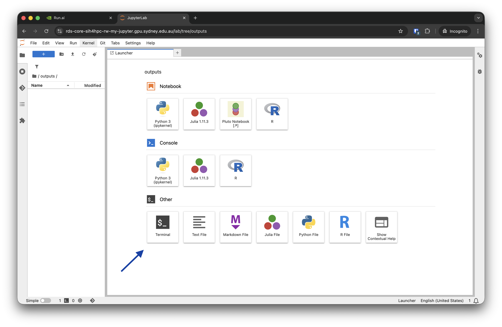

# How to transfer data to and from the Persistent volume claim

This page describes how to move data between your Persistent Volume Claim (PVC) on the Apollo GPU cluster, the Research Data Store (RDS), your own computer, and other institutions, and how to check that it arrived intact.

Here we assume you already have set up a [project](runai_features.md#runai-projects) and have some Persistent Volume Claim (PVC) [storage](runai_features.md#runai-data-sources) available.

## Choose a route

| Route | Use it for | What you need |
|---|---|---|
| **Globus** | Anything sizeable: RDS ↔ PVC, another institution ↔ PVC, your computer ↔ PVC | A Globus login with your University account; [Globus Connect Personal](https://www.globus.org/globus-connect-personal) on your computer for laptop transfers |
| **sftp from a data-transfer workspace** | RDS ↔ PVC when Globus is not set up for you, or a handful of files | Your UniKey password for RDS |
| **Download inside a workload** | Public datasets and models | Nothing: workloads have internet access, so download straight to the PVC rather than via your computer |

::: {.callout-important}
Check your project's data rules before moving research data anywhere, including onto the cluster. Everything on a project's PVC can be read by every member of that project, and the PVC is **not backed up**. Never create a Globus share or guest collection of your PVC unless you mean to give other people access to it.
:::

## Before you transfer

1. **Check there is room.** A DashR project's PVC is 1 TB by default, and it is shared by everyone in the project. In a terminal on the cluster (for example the data-transfer workspace below), run `df -h <pvc_mount_point>`.
2. **Know what you are sending.** Note the number of files and the total size at the source, so you can compare them afterwards.
3. **Do not hold a GPU while transferring.** Transfers only need a CPU workspace, or no workspace at all with Globus.

## Transfer with Globus

[Globus](https://sydneyuni.atlassian.net/wiki/spaces/RC/pages/3492052996/Globus+Data+Transfer) moves large amounts of data reliably. It retries failed files, checks every file's checksum after transfer, and keeps going if you close your browser.

1. Go to [app.globus.org](https://app.globus.org) and log in with your University of Sydney account.
2. Open the **File Manager**. In one panel, search for the collection you are copying **from**; in the other, the collection you are copying **to**:
   * the GPU cluster is **The University of Sydney Apollo GPU cluster (on-campus transfers)**, or **(off-campus transfers)** when the other end is off campus. Project storage is under `/mnt/gpu/<your project>/`. If your project is not there, ask SIH whether it has been made available to Globus;
   * your RDS project is **PRJ-&lt;your project short ID&gt; on Sydney RDS (on-campus transfers)**, or **(off-campus transfers)**;
   * to transfer from or to your own computer, install [Globus Connect Personal](https://www.globus.org/globus-connect-personal) and select your computer's collection.

   More detail is on the University's [Globus page](https://sydneyuni.atlassian.net/wiki/spaces/RC/pages/3492052996/Globus+Data+Transfer).
3. Browse to your project's directory on the PVC (not the shared root, which is not writable) and to the source files, and select what to copy.
4. Open **Transfer & Timer Options**:
   * Tick **sync - only transfer new or changed files**, so that re-running the same transfer copies only what changed.
   * Leave file-integrity verification on (the default), so every file is checksummed after it arrives.
   * Leave the option to delete files on the destination that are not on the source switched off, unless you are sure: it deletes data.
5. Click **Start**. The **Activity** page shows progress, and Globus emails you when the transfer finishes.

## Interactive data transfer to/from RDS from a web-browser

## Interactive data transfer to/from RDS from a web-browser

You can easily transfer data between your Persistent Volume Claim (PVC) and RDS from inside the Run:ai web browser interface. We have set up an [environment](runai_features.md#runai-environments) called `data-transfer` for you to do this.

To run the `data-transfer` environment from a template:

1. Log into the Run:ai dashboard at [gpu.sydney.edu.au](https://gpu.sydney.edu.au) and use Okta to login with your credentials via the "CONTINUE WITH SSO" sign in option.

2. Click the 'Workload manager' icon in the left panel and then select 'Workloads' in the menu. Next select the green '+ NEW WORKLOAD' icon in the top left of the workloads screen and select 'Workspace'.



3. Select your project from the projects available and select the `data-transfer-workspace` template and give your workspace a name before selecting 'Advanced Setup' on the bottom right.

4. If you have selected the `data-transfer-workspace` template, you should now have pre-populated the required `Environment` and `Compute resources` fields on the following page. You can double check this now.

5. Expand the `Data & storage` box and select the small icon in the top left. You will see a list of PVCs associated with your project, select this from the list.



6. When you are happy with everything, click CREATE WORKSPACE and your data transfer environment will be created. When this is provisioned click the CONNECT icon above the list of workloads. 



7. You will again be prompted for your Run:ai login and your newly created JupyterLab session will appear in a new tab in your browser. Select the 'Terminal' app there.



8. In the open terminal app you can now use the sftp command to copy data to/from your project space in RDS.

To copy data from RDS to the GPU cluster, you can type the following into the open terminal:

::: {.callout-note}
Be sure to replace everything in brackets `<` `>` with values specific to the data you are trying to copy as follows:

`<your_unikey>`: Your University of Sydney unikey, usually in the form abcd0123.

`<rds_project>`: The name of the project you have on [DashR](https://dashr.sydney.edu.au/) with data stored in RDS.

`<path_to_project_data>`: The location of your storage directory under your project on RDS. (e.g. `my_project_data/my_project_data_for_dgx/`)

`<pvc_mount_point>`: The location your PVC has been mounted (this is established when your PVC is provisioned). (e.g. `/scratch`)

`<path_to_pvc_data>`: The path of the data you have stored on the PVC. (e.g. `my_dgx_data/workflow_output/`)
:::

```bash
sftp -r <your_unikey>@research-data-ext.sydney.edu.au:/rds/PRJ-<Project Short ID>/<Path to File or Folder> <pvc_mount_point>/<path_to_pvc_data>
```

After you execute this command, you will be prompted for the password associated with your unikey to establish a connection to RDS. 

To copy data from the GPU cluster to RDS, reverse the order of source and destination in the above command:

```bash
sftp <your_unikey>@research-data-ext.sydney.edu.au:/rds/PRJ-<Project Short ID>/<Path to File or Folder> <<< $"put -r <pvc_mount_point>/<path_to_pvc_data>"
```

During file transfer, for larger files, you can close the browser and leave things running in the background. You can then reconnect to check its status by logging back into the web UI at [gpu.sydney.edu.au](https://gpu.sydney.edu.au).

### If an sftp transfer is interrupted

Running the same `sftp -r` command again copies everything again. OpenSSH's `sftp` can instead resume partially copied files with `reget` (downloads) and `reput` (uploads), for example:

```bash
sftp <your_unikey>@research-data-ext.sydney.edu.au <<< "reget -r /rds/PRJ-<Project Short ID>/<Path to File or Folder> <pvc_mount_point>/<path_to_pvc_data>"
```

::: {.callout-note}
We have not yet confirmed resuming against RDS. If it fails, re-run the original command. For very large transfers, Globus is the better choice.
:::

## After you transfer

1. **Check that everything arrived.** At minimum, compare the number of files and the total size on both sides. In a terminal on the cluster:

    ```bash
    find <pvc_mount_point>/<path_to_pvc_data> -type f | wc -l
    du -sh <pvc_mount_point>/<path_to_pvc_data>
    ```

    For a full check, the [`manifest.py`](https://github.com/Sydney-Informatics-Hub/gpu-cluster-onboarding-guide/blob/main/ai-agents/scripts/manifest.py) script records every file's size and checksum on one side (`python3 manifest.py build <folder> -o files.manifest`). It then checks the copy on the other side (`python3 manifest.py check <folder> files.manifest`) and lists anything missing or different. Globus already verifies checksums for you.

2. **Stop the data-transfer workspace** when you are finished. It uses no GPU, but it holds CPU cores and memory on a shared node until you stop or delete it.

3. **Copy results back the day you make them.** The PVC is temporary storage: unused files must be deleted within 30 days of job completion, and it is not backed up. Anything worth keeping, such as trained models and results, belongs on RDS.
