# Audio Transcription & Translation — User Guide

## Overview

This app transcribes and optionally translates audio files. You configure your settings in the sidebar on the left, upload your files, run processing, then download the results.

---

## Step 1: Configure Settings (Left Sidebar)

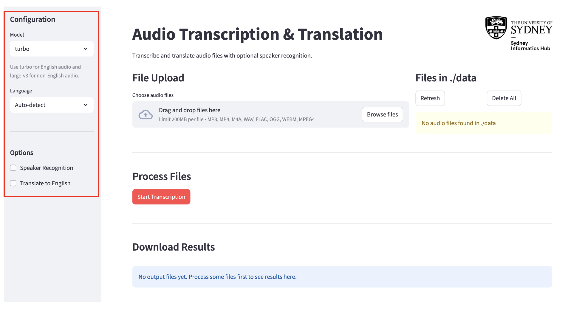

### Model

Choose the Whisper model to use for transcription:

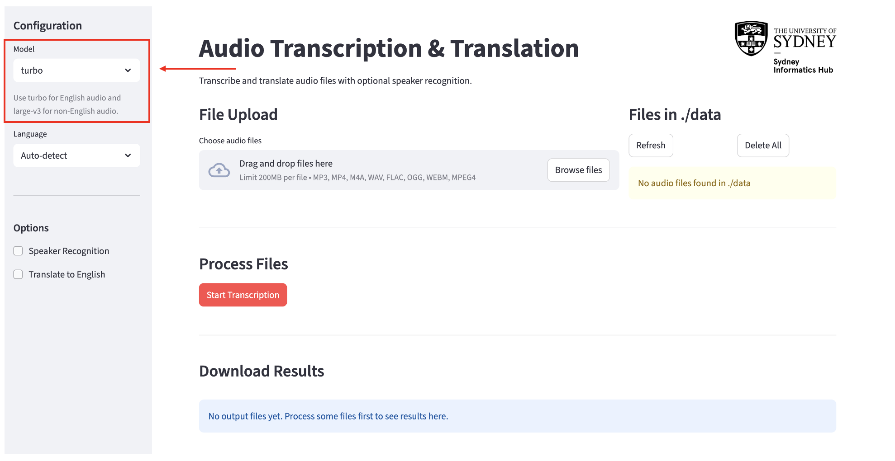

- **`turbo`** *(default)* — use this for **English-only audio** when you want faster processing.
- **`large-v3`** — use this for **non-English audio**, or when you need the highest accuracy. Slower but more powerful.

### Language

Select the language spoken in your audio files.

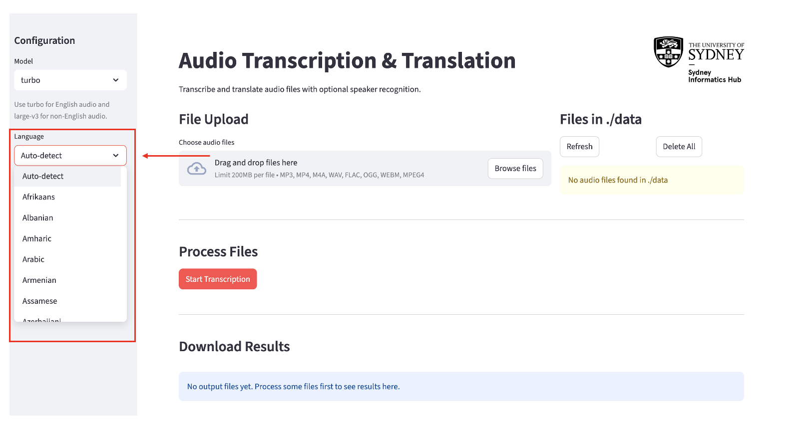

- **Auto-detect** *(default)* — the model will guess the language automatically. Works well in most cases.
- If you **know** the language, select it from the dropdown. This is more accurate than auto-detect and recommended when processing non-English audio.

### Options

**Speaker Recognition**

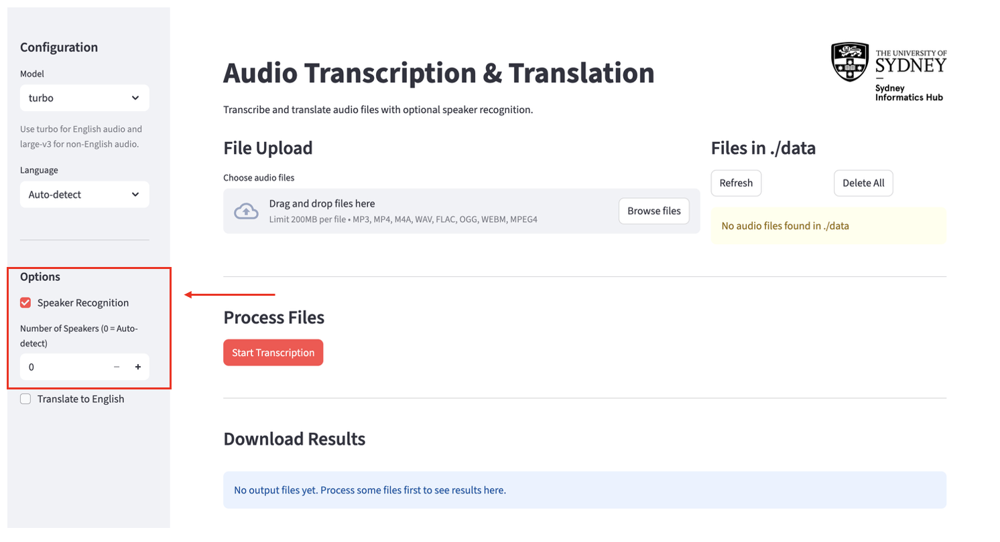

- Check this box **only if your audio has more than one speaker** and you want the transcript to identify who said what (e.g. "SPEAKER_01: Hello").
    - If there is only **one speaker**, leave this unchecked. Enabling it for single-speaker audio can reduce accuracy and may incorrectly split one person's speech across multiple "speakers."
- When enabled, a **Number of Speakers** field appears:
    - Enter `0` to let the app auto-detect how many speakers there are.
    - Enter the exact number of speakers (e.g. `2`) for **more accurate** results. Use this whenever you know how many people are in the recording.
    - Maximum supported: 20 speakers.

**Translate to English**

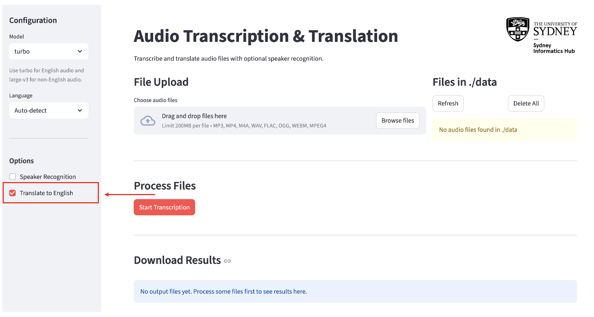

- Check this box if you want the output translated into English, regardless of the source language.
- Can be combined with Speaker Recognition — the transcript will show speaker labels and English text together.

---

## Step 2: Upload Your Audio Files

Supported formats: **MP3, MP4, M4A, WAV, FLAC, OGG, WEBM**

1. In the **File Upload** section, click **Upload**.

    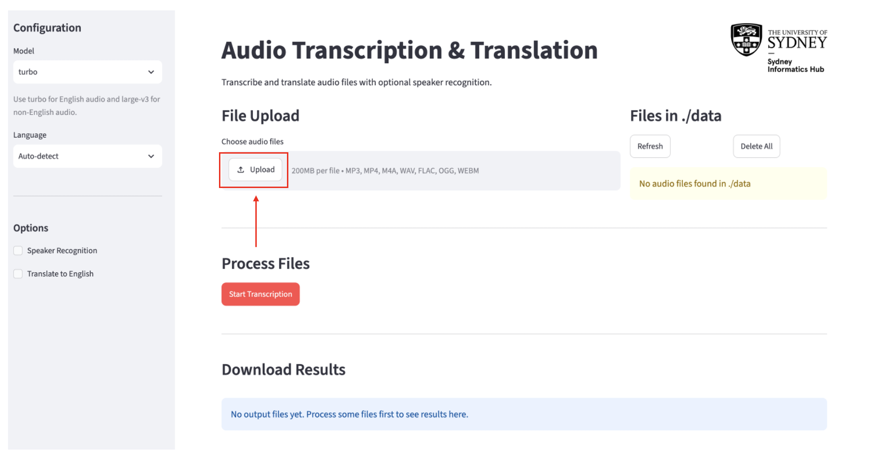

2. You can select **multiple files** at once.

The **Files in ./data** panel on the right shows everything currently queued for processing. From here you can:

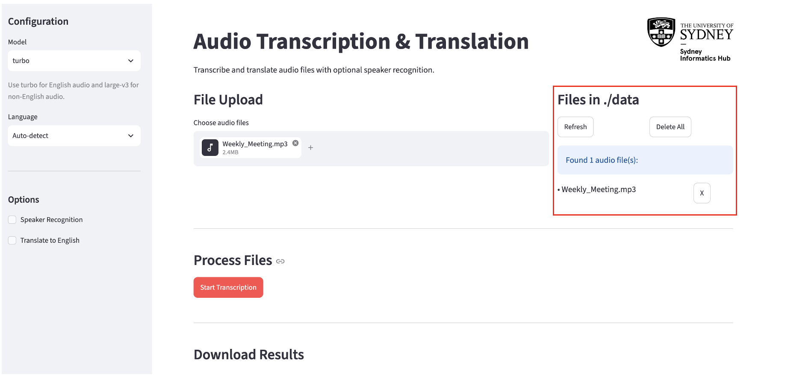

- Click **Refresh** to update the list.
- Click **X** next to a file to remove it individually.
- Click **Delete All** to clear every file in the queue.

---

## Step 3: Run Transcription

Once your files are uploaded and your settings are configured, click the **Start Transcription** button.

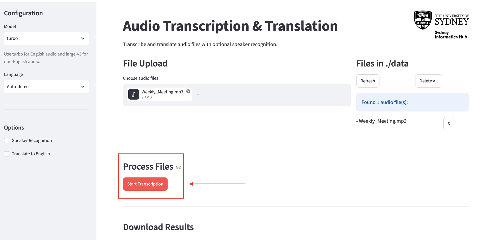

- A progress bar and status message will appear showing which file is being processed and how many remain.
- Logs appear at the bottom of the page in real time.
- Processing time depends on file length, the model chosen, and whether speaker recognition is enabled.

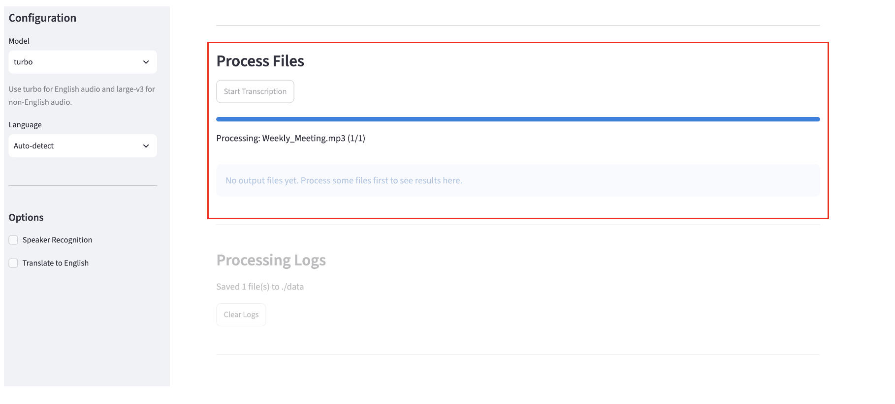

::: {.callout-note}
Do not change settings or navigate away while processing is running.
:::

---

## Step 4: Download Results

When processing finishes, the **Download Results** section shows your output files.

- **Download All (ZIP)** — downloads a `transcriptions.zip` archive containing your results:
    - `.srt` and `.txt` files for your output
    - if translation was used, the transcription in the original language as well as the translated English file
    - a `reference.txt` file with a research blurb and methodology

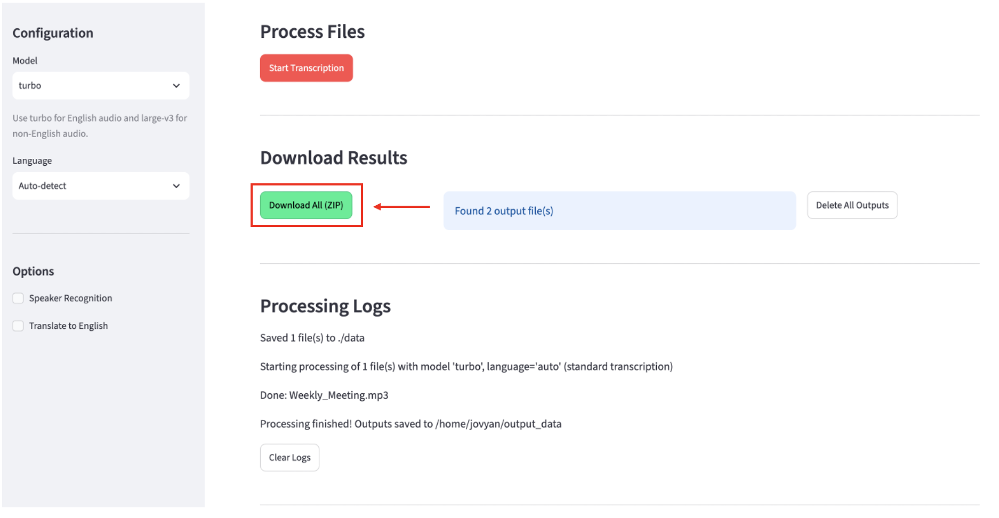

- Click **Delete All Outputs** to remove all output files.

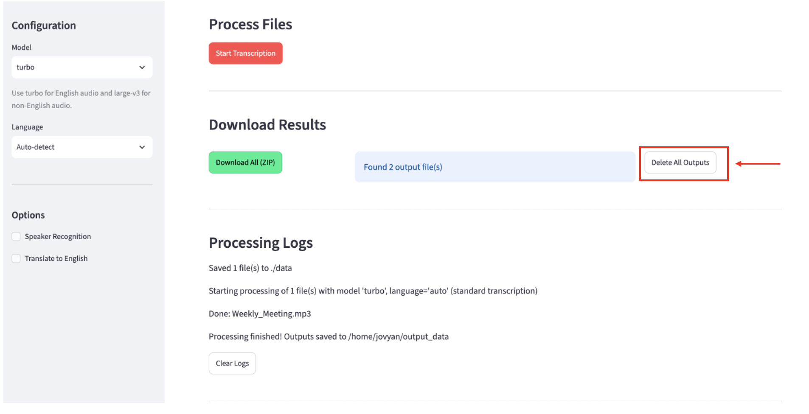

---

## Processing Logs

The **Processing Logs** section at the bottom records what happened during each run — which files were processed, any errors, and when processing completed.

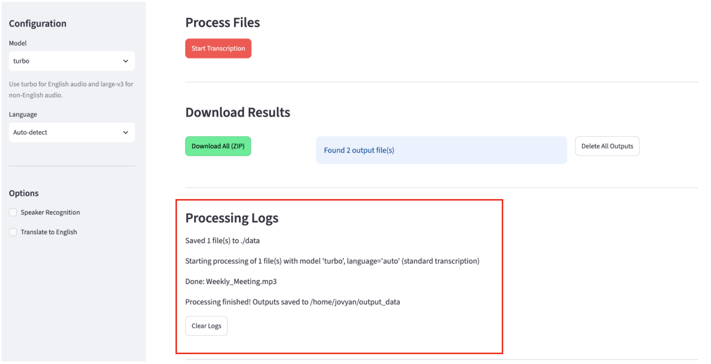

Click **Clear Logs** to reset the log view.

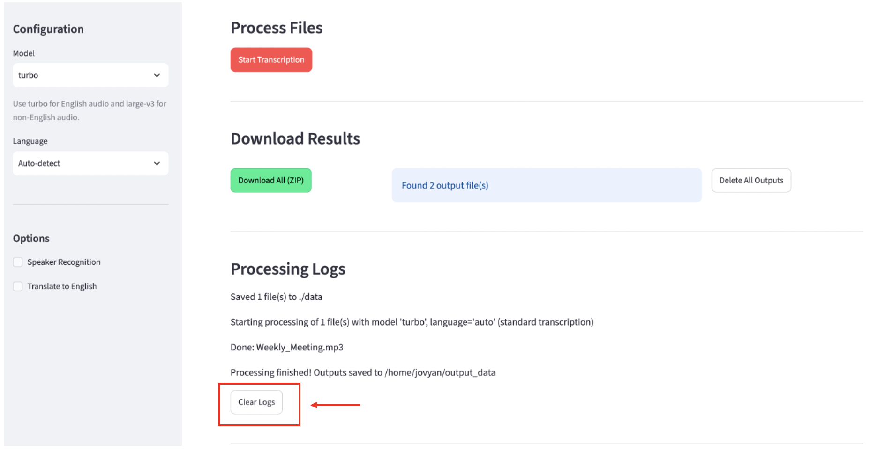

---

## Quick Reference

| Goal | Settings |
|---|---|
| Transcribe English audio, fast | Model: `turbo`, Language: `English` |
| Transcribe non-English audio | Model: `large-v3`, Language: select yours |
| Identify speakers in a recording | Enable **Speaker Recognition**; set number of speakers if known |
| Get an English translation of foreign audio | Enable **Translate to English** |
| Transcribed translation with speaker labels | Enable both **Speaker Recognition** and **Translate to English** |

# Human validation of your transcript

Do not skip this step if you plan to use the transcript/translation in your research!

## Why use it to check your transcription?

Automated transcription is accurate but not perfect. Background noise, overlapping speech, strong accents, or technical terminology can all cause errors that are easy to miss when reading a transcript on its own. Subtitle Edit solves this by keeping your audio and your text in sync — you can click on any line, hear exactly what was said at that moment, and correct it immediately without losing your place.

This is especially important when:

- The audio contains **multiple speakers** and you need to verify speaker labels are correct
- You are working with **non-English audio** and want to check the transcription or translation against the original
- **Accuracy matters** — for research, legal, medical, or accessibility purposes where errors have real consequences

## What is Subtitle ?

[Subtitle Edit](https://www.nikse.dk/subtitleedit) is a free, open-source tool originally designed for creating and editing subtitles. It is also an excellent way to review and correct transcription output, because it lets you play back your audio and edit the text at the same time, in the same window.

## Getting started

1. Download the correct file for your operating system from [SubtitleEdit](https://github.com/SubtitleEdit/subtitleedit/releases) and follow the installation instructions.

2. Open the Subtitle Edit application.

3. Load your `.srt` transcription file: **File → Open**.

    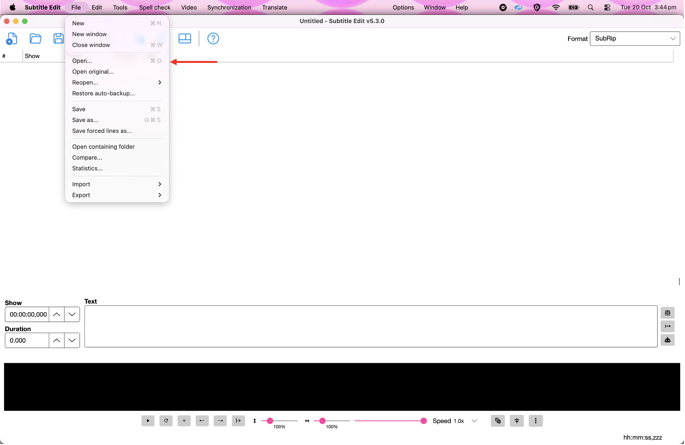

4. Load your audio file: **Video → Open video...**.

    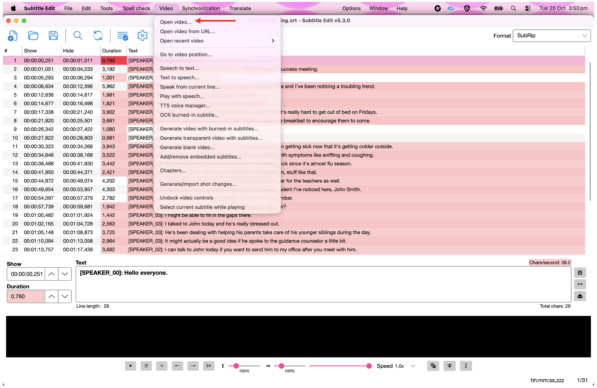

7. Double Click any line in the subtitle grid to jump to that moment in the audio and play it back.

    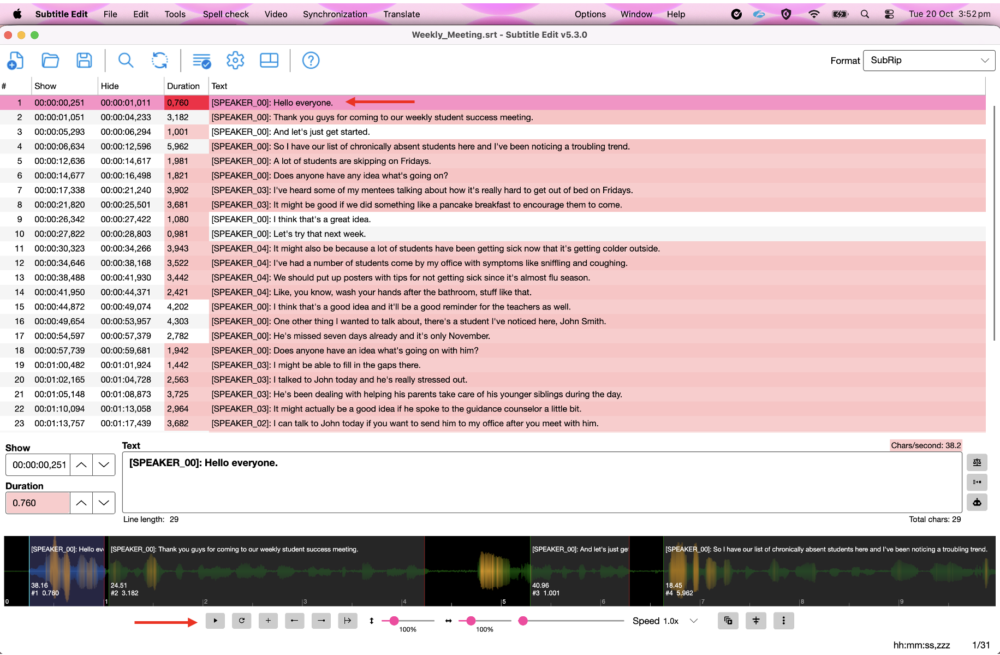

8. Edit the text directly in the edit box above the waveform, then move on to the next line.

    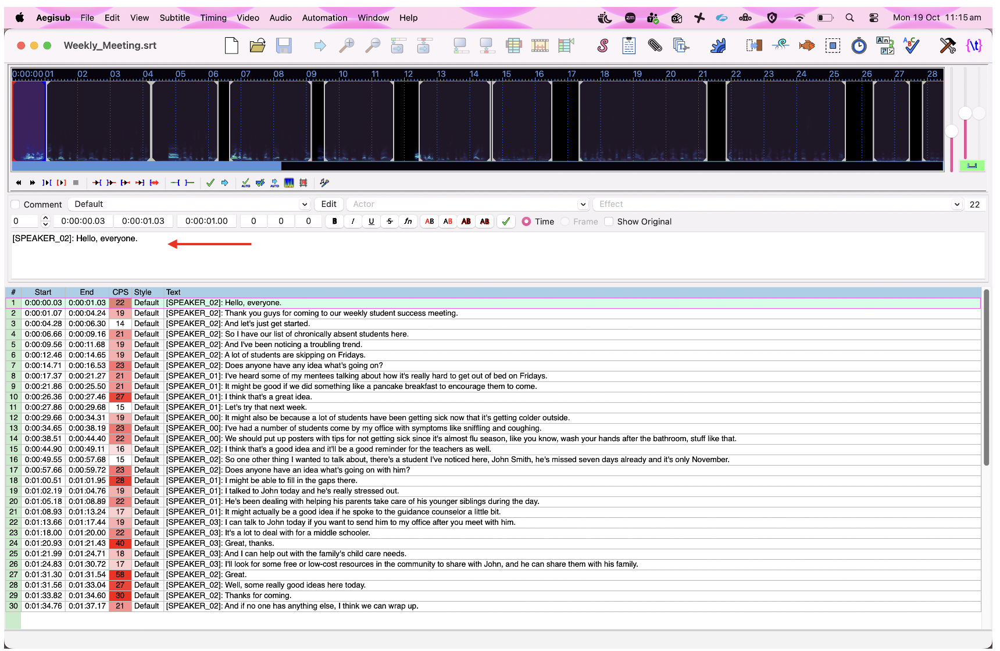

9. To save your changes, select **File → Save as...**.

    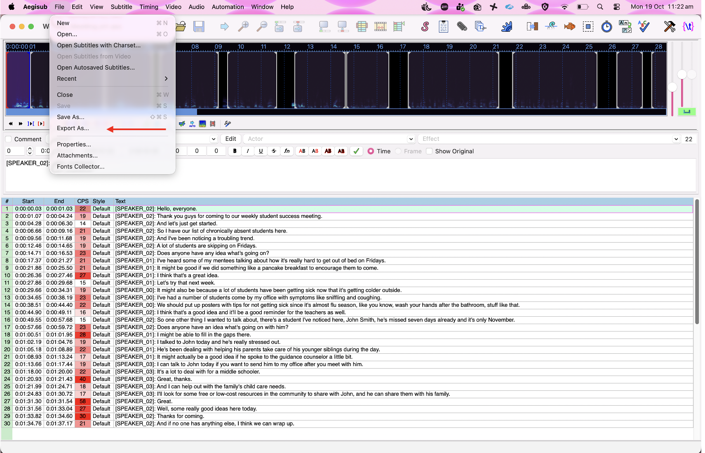

10. Enter a name for your file and choose a location to save it. Ensure the **File format** is **SubRip**. Finally click **Save**.

    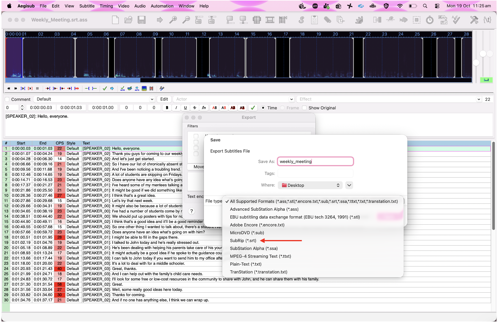

# Human validation of your translation

Before validating your translation, first follow the steps above to check and correct the `.srt` transcript in the original language.

Once you are satisfied that the original-language transcript is accurate:

1. Open the checked `.srt` file in the original language in your preferred text editor.
Open the English translation .srt file in a second window and place the two files side by side.

2. Work through the files line by line, comparing the English translation with the checked original-language transcript.

3. Correct any translation errors, missing information, or wording that does not accurately reflect the meaning of the original transcript.

4. Save the corrected English translation as a new `.srt` file.