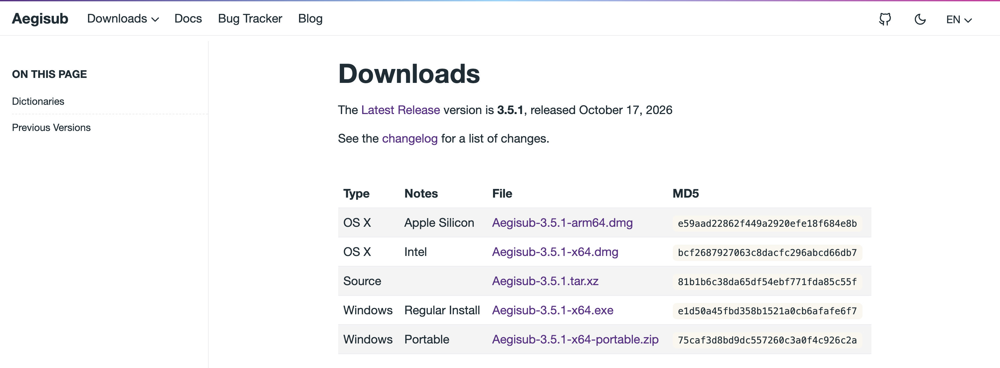
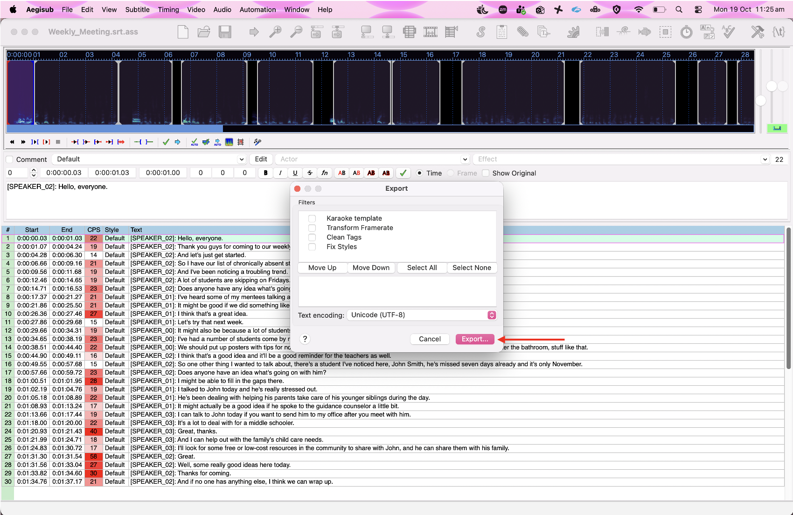
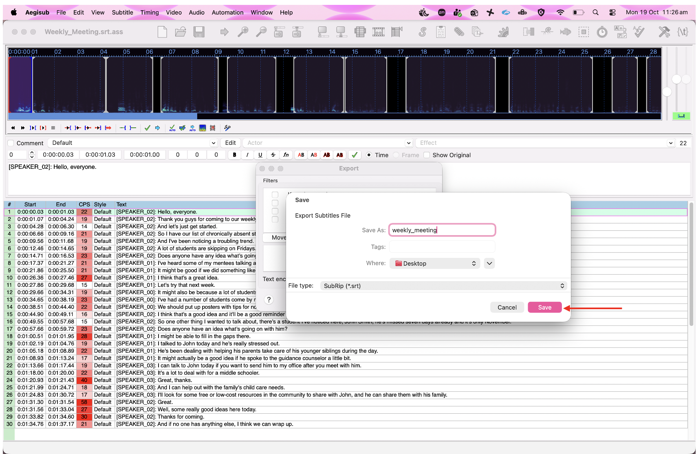

# Human validation of your transcript

Do not skip this step if you plan to use the transcript/translation in your research!

## Why use it to check your transcription?

Automated transcription is accurate but not perfect. Background noise, overlapping speech, strong accents, or technical terminology can all cause errors that are easy to miss when reading a transcript on its own. Aegisub solves this by keeping your audio and your text in sync — you can click on any line, hear exactly what was said at that moment, and correct it immediately without losing your place.

This is especially important when:

- The audio contains **multiple speakers** and you need to verify speaker labels are correct
- You are working with **non-English audio** and want to check the transcription or translation against the original
- **Accuracy matters** — for research, legal, medical, or accessibility purposes where errors have real consequences

## What is Aegisub?

[Aegisub](https://aegisub.org/) is a free, open-source tool originally designed for creating and editing subtitles. It is also an excellent way to review and correct transcription output, because it lets you play back your audio and edit the text at the same time, in the same window.

## Getting started

1. Download the correct file for your operating system from [aegisub.org](https://aegisub.org/downloads/) and follow the installation instructions.

    

2. Open the Aegisub application.

3. Load your `.srt` transcription file: **File → Open**.

    

4. Load your audio file: **Audio → Open Audio File...**.

    

7. Click any line in the subtitle grid to jump to that moment in the audio and play it back.

    

8. Edit the text directly in the edit box below the waveform, then move on to the next line.

    

9. To export your changes, select **File → Export as...**.

    

10. In the window that appears, click **Export**. 

    

11. Enter a name for your file and choose a location to save it. From the **File type** dropdown menu, select **SubRip (*.srt)**.

    

12. Finally click **Save**

    

# Human validation of your translation

Before validating your translation, first follow the steps above to check and correct the .srt transcript in the original language.

Once you are satisfied that the original-language transcript is accurate:

1. Open the checked .srt file in the original language in your preferred text editor.
Open the English translation .srt file in a second window and place the two files side by side.

2. Work through the files line by line, comparing the English translation with the checked original-language transcript.

3. Correct any translation errors, missing information, or wording that does not accurately reflect the meaning of the original transcript.

4. Save the corrected English translation as a new .srt file.